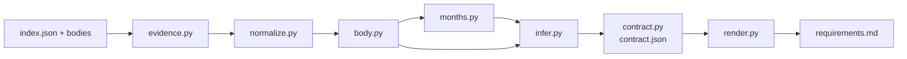

# Design Document: Autopsy

## Overview

`revenant autopsy <slug>` reads Exhume's `index.json` and capture bodies, infers the contract in memory
with pure functions, validates it as a Pydantic v2 `Contract`, writes `crypt/<slug>/contract.json`, then
re-reads that file and renders `.kiro/specs/revenant-<slug>/requirements.md`. No LLM, network or new
dependency. All reads and inference finish before the first write, so an input error writes nothing.

## Architecture



Reused from Exhume (imported, never copied): `Index`, `IndexEntry` from `revenant.exhume.models`;
`parse_query`, `parameter_shape`, `interval` from `revenant.exhume.select`; `atomic_write` from
`revenant.exhume.store`. Entries with `digest_verified=false` (chunked transfer-encoding, F19) are used
like verified entries; only the SHA-256 check of Req 1.3 gates a body.

## Components and Interfaces

All modules live in `revenant/autopsy/`, each under ~150 LOC. `AutopsyError(path: str, message: str)`
in `evidence.py` is the single input-error type; the CLI turns it into exit code 1.

**evidence.py**: Evidence_Reader.
- `@dataclass(frozen=True) class Capture`: `key: str`, `entry: IndexEntry`, `body: bytes`.
- `load_evidence(evidence_dir: Path, slug: str) -> tuple[bytes, list[Capture]]`: returns the raw
  `index.json` bytes and every entry in sorted key order. Raises `AutopsyError` for a missing or
  invalid Index, a slug mismatch, a missing body or a SHA-256 mismatch.
- `capture_year(entry: IndexEntry) -> int`, `capture_date(entry: IndexEntry) -> date` (Glossary rules).

**normalize.py**: Query_Normalizer.
- `unescape_fixpoint(text: str) -> str`: `html.unescape` until unchanged (each change shortens the text).
- `normalize_query(original: str) -> list[tuple[str, str]]`: takes `urlsplit(original).query`, applies
  `unescape_fixpoint`, then calls Exhume's `parse_query("?" + query)`. At the fixpoint, parse_query's own
  unescape is a no-op. Shape and Interval come from Exhume's `parameter_shape` and `interval`.

**body.py**: Body_Parser and row helpers.
- `@dataclass(frozen=True) class ParsedBody`: `header`, `rows`, `comments`, `comments_after_last_row`, `comments_before_last_row`.
- `parse_body(body: bytes, path: str) -> ParsedBody`: strict UTF-8 decode (raises `AutopsyError`
  naming `path`), split at `\n` only, Comment_Line regex `^<!--.*-->\s*$`. Line-ending quirks are deferred.
- `parse_row_date(field: str, capture_year: int) -> tuple[date, str] | None`: `%Y-%m-%d` or `%d-%b-%y`.
  English month abbreviations come from a fixed table, never the locale. A two-digit year `yy` resolves to
  `capture_year - ((capture_year - yy) % 100)`.
- `row_order(dates: Sequence[date]) -> Literal["descending", "ascending", "unordered"]`: needs ≥ 2 dates.
- `body_precision(header: str, rows: Sequence[str]) -> int`: skips the `Date` and `Volume` columns.

**months.py**: Month_Detector.
- `@dataclass(frozen=True) class MonthSample`: `key`, `params` (`a` to `f`), `oldest`, `newest`.
- `fits(sample: MonthSample, h: int) -> bool`: false for non-integer values or invalid dates.
- `detect(samples: Sequence[MonthSample]) -> MonthResult`: counts Decisive (per H), Ambiguous and Unfit
  samples and applies the ≥ 3 and none-for-the-other rule of Req 3.2 and 3.3.

**infer.py**: Contract_Inferrer.
- `infer(slug: str, index_bytes: bytes, captures: Sequence[Capture]) -> Contract`: keeps `data` and
  `error` kinds, ignores `error_page`, re-sorts captures by key (never trusts caller order), and builds
  each Contract section with one private helper per requirement group.
- Default spacing (Req 6.3): `statistics.median` of pooled absolute day gaps. A half-day median such as
  4.5 falls outside every band and gives `unknown`.

**contract.py**: Contract model and Contract_Writer.
- Pydantic models below, all with `ConfigDict(extra="forbid", frozen=True)`.
- `dump_contract(contract: Contract) -> bytes`: Exhume's `dump_index` recipe (sorted keys, indent 2,
  `ensure_ascii=False`, trailing `\n`, UTF-8).
- `write_contract(contract: Contract, crypt_dir: Path) -> Path`: `atomic_write` to `<slug>/contract.json`.
- `load_contract(path: Path) -> Contract`: `Contract.model_validate_json(path.read_bytes())`.

**render.py**: Spec_Renderer, string templates only.
- `render(contract: Contract) -> str`: fixed section order, f-strings and `"\n".join`, one trailing newline.
- `write_spec(contract: Contract, specs_dir: Path) -> Path`: `atomic_write` to `revenant-<slug>/requirements.md`.
- Selection follows the tie-breaks of Req 8.3, 8.4 and 8.6 exactly, so no choice depends on dict order.

**revenant/cli.py**: `@app.command() autopsy(slug: str, evidence_dir: Path = Path("evidence"), crypt_dir:
Path = Path("crypt"), specs_dir: Path = Path(".kiro/specs")) -> None`, a sibling of `exhume`. Flow:
`load_evidence` → `infer` → `write_contract` → exit 2 if `undetermined` → `load_contract` (from disk) →
`render` → `write_spec`. Prints month indexing, both Decisive counts and each written path (POSIX).

## Data Models

`Evidence` is attached to every inferred fact (Req 7.3). Lists are sorted by the key shown in brackets.
Dates are ISO `YYYY-MM-DD` strings.

```python
class Evidence(BaseModel):  count: int; keys: list[str]            # [key asc], at most 3
class Source(BaseModel):    index_sha256: str; entry_count: int
class Endpoint:   path: str; hosts: list[HostEvidence]              # hosts [host]
class Parameter:  name: str; documented: bool; present: Evidence; empty: int; junk: int
                  required: bool; examples: list[str]               # [count desc, value asc], at most 5
                  type: IntType | EnumType | StringType             # discriminator "kind"
class EnumType:   kind: Literal["enum"]; values: list[ValueCount]   # [value]
class Months:     indexing: Literal["0-indexed", "1-indexed", "undetermined"]
                  decisive_h0: Evidence; decisive_h1: Evidence; ambiguous: Evidence; unfit: Evidence
class Variant:    header: str; columns: list[str]; first_year: int; last_year: int; evidence: Evidence
class IntervalVariants: interval: str; variants: list[Variant]      # variants [header]
class Precision:  interval: str; header: str; year: int; values: list[DigitsCount]  # values [digits]
class Comments:   total: int; years: list[int]; example: str | None; after_last_row: int
                  before_last_row: int; evidence: Evidence          # years [year]
class Default:    shape: Literal["s_only", "empty_range"]; evidence: Evidence; earliest: str | None
                  latest: str | None; recent_within_7d: int; spacing: Literal["d", "w", "m", "unknown"]
class ErrorStatus: status: str; evidence: Evidence; media_types: list[NameCount]; shapes: list[NameCount]
class Contract(BaseModel):
    slug: str; source: Source
    endpoints: list[Endpoint]                  # [path]
    parameters: list[Parameter]                # [name]; `amp` excluded
    amp: Evidence
    months: Months
    content_types: list[NameEvidence]          # [name]
    intervals: list[IntervalVariants]          # [interval]
    headers: list[Variant]                     # [header]
    header_only: Evidence
    date_formats: list[FormatEvidence]         # [format]
    row_order: RowOrder                        # descending, ascending, unordered, unparsed_dates: Evidence
    precision: list[Precision]                 # [interval, header, year]
    comments: Comments
    defaults: list[Default]                    # [shape]
    errors: list[ErrorStatus] | None           # [status]; media_types and shapes [name]
```

String sorts use code-point order. `columns` keeps header order, because order is the fact.

## Determinism Rules

- Inference never iterates a set or dict without sorting first. `infer` re-sorts captures by key.
- No wall-clock time, absolute path, locale, hostname or environment value enters the Contract or the
  rendered file. `Source` holds only the entry count and SHA-256 of the `index.json` bytes.
- Evidence keys are the first 3 keys in ascending order. `dump_contract` and `render` are pure.

## Correctness Properties

*A property is a characteristic or behavior that should hold true across all valid executions of a system-essentially, a formal statement about what the system should do. Properties serve as the bridge between human-readable specifications and machine-verifiable correctness guarantees.*

### Property 1: Month recovery

For any offset H in {0, 1} and any set of `full_range` samples generated with H that contains at least 3
Decisive_Captures (plus any Ambiguous or Unfit noise), `detect` returns H's indexing; adding one
Decisive_Capture for the other offset returns `undetermined`.

**Validates: Requirements 3.1, 3.2, 3.3, 3.4**

### Property 2: Byte-identical contract

For any synthetic evidence set and any permutation of its captures, `dump_contract(infer(...))` returns
the same bytes.

**Validates: Requirements 7.4, 7.6**

### Property 3: Unescape fixpoint

For any query over `[A-Za-z0-9^%.=&]` HTML-escaped 0 to 3 times, `normalize_query` returns the same pairs
as Exhume's `parse_query` on the unescaped query.

**Validates: Requirements 2.1**

### Property 4: Parsed row order

For any strictly descending date list of length ≥ 2 within the 100 years up to the Capture_Year, with
each row rendered in either Row_Date format, `row_order` of the parsed dates returns `descending`. Month
and year boundaries, where string order fails, are included.

**Validates: Requirements 5.2**

## Error Handling

| Failure | Files written | Exit |
|---|---|---|
| `index.json` missing, bad JSON, invalid, slug mismatch | none | 1 |
| Body missing or SHA-256 mismatch | none | 1 |
| Data_Capture body not UTF-8 | none | 1 |
| Contract `ValidationError` (message names the field `loc`) | none; old `contract.json` kept | 1 |
| `OSError` during an atomic write | target untouched, temp removed | 1 |
| Month indexing `undetermined` | `contract.json` only | 2 |
| Success | `contract.json` and `requirements.md` | 0 |

Errors go to stderr as `error: <file>: <message>`, file paths in POSIX form.

## Testing Strategy

pytest + Hypothesis, `@settings(max_examples=100)`, tag `# Feature: autopsy, Property <n>: <title>`.
Tests build evidence in `tmp_path` from synthetic bodies; some examples read the committed
`evidence/yahoo-finance-ichart/` read-only. No test creates an httpx client.

| Property | Module | Test file |
|---|---|---|
| P1 Month recovery | `months.py` | `tests/autopsy/test_months.py` |
| P2 Byte-identical contract | `infer.py`, `contract.py` | `tests/autopsy/test_contract.py` |
| P3 Unescape fixpoint | `normalize.py` | `tests/autopsy/test_normalize.py` |
| P4 Parsed row order | `body.py` | `tests/autopsy/test_body.py` |

Example-based tests:
- `test_evidence.py`: each Req 1.3 failure, sorted key order, a `digest_verified=false` entry is accepted.
- `test_body.py`: F16 comment line, Header_Only_Body, non-UTF-8 body, both date formats, precision.
- `test_infer.py`: typing and `amp`, `g=v` → `Date,Dividends`, `Adj. Close*` vs `Adj Close`, defaults,
  errors present and null, `error_page` ignored; committed evidence gives `0-indexed`.
- `test_render.py`: rendering a fixed contract twice gives identical bytes; tie-breaks of Req 8.3, 8.4, 8.6.
- `test_cli.py`: `CliRunner` for exit codes 0/1/2, no writes on exit 1, summary, two working directories.
