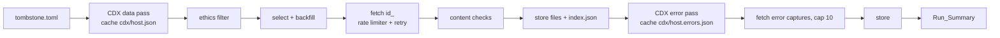

# Design Document: Exhume

## Overview

`revenant exhume <slug>` loads `tombstones/<slug>.toml`, lists each Host's archived captures through the
CDX API (data pass), drops Auth-like URLs, picks a deterministic sample of at most N per Host, downloads
raw `id_` captures through one rate-limited, retrying sync httpx client, rejects Offline pages and stores
the rest under `evidence/<slug>/` with a byte-stable `index.json`. An error pass then keeps up to 10
Error_Evidence items, and a Rich table summarises each Host. Requests run one at a time.

## Architecture



Decisions:
- **Timeouts**: `httpx.Timeout(connect=10.0, read=60.0, write=10.0, pool=10.0)`. The 5 s default times
  out on 1,000-row CDX pages from a busy Archive.
- **Rate limiting**: `event_hooks={"request": [rate_limiter.on_request]}` with `follow_redirects=True`.
  httpx fires the hook per redirect hop, so hops are spaced. The hook is sync, so the client is a sync
  `httpx.Client`. Retries wrap `client.get` inside `ArchiveClient.get`, so each attempt is spaced too.
- **Served timestamp**: final `response.url` path `/web/<14 digits>id_/`, else `Memento-Datetime` (UTC), else null.
- **CDX**: `limit=1000`; one `filter=mimetype:<regex>` (`text/csv`, `(text/csv|text/xml)`, members
  regex-escaped), because CDX ANDs repeated filters.
- **JSON**: Index with `sort_keys=True, indent=2` and a trailing newline (byte-stable); Listings compact
  (`separators=(",", ":")`). Both use an Atomic write: temp file in the target dir, then `os.replace`.
- **Config**: User-Agent from env `REVENANT_USER_AGENT`, default
  `Revenant/0.1 (+https://github.com/Manthan-1610/revenant)`. No config file.
- **File name** uses the CDX (requested) timestamp, so the cache key is known before fetching.
- **`<original>`** is passed unchanged: httpx sends `^` unencoded, and `s=^DJI` got 200, 0 redirects, matching digest (F11). Bodies are stored as-is whatever the CSV header (F12).
- **Rerun short-cut**: a Host with ≥ N cached `data` entries among its Candidates counts N cached, no requests.
- **Known MVP limitation**: over-cap error pages are discarded unrecorded, so reruns refetch them (deferred).

## Components and Interfaces

Eight modules in `revenant/exhume/`, each under ~150 LOC. The Tombstone loader sits in `models.py`.

**models.py**: models below, plus
- `load_tombstone(slug: str, root: Path = Path("tombstones")) -> Tombstone`: `tomllib` + validation +
  slug/file-name check; raises `TombstoneError` naming the file and fields.

**archive.py**: polite HTTP.
- `class Clock(Protocol)`: `monotonic() -> float`, `sleep(seconds: float) -> None`, `now_utc() -> datetime`.
  `class SystemClock` implements it with `time` and `datetime`.
- `user_agent() -> str`: env `REVENANT_USER_AGENT` or `DEFAULT_USER_AGENT`.
- `class RateLimiter(clock: Clock, min_interval: float = 1.0)`; `on_request(self, request: httpx.Request)
  -> None` sleeps through `clock.sleep` until `min_interval` has passed since the last start.
- `parse_retry_after(value: str | None, now: datetime) -> float`: seconds or HTTP date, 0 if bad.
- `backoff_delay(attempt: int, retry_after: float) -> float`: `min(60, max(2 * 2**(attempt-1), retry_after))`.
- `make_client(limiter: RateLimiter, ua: str, transport: httpx.BaseTransport | None = None) -> httpx.Client`.
- `class ArchiveClient(client: httpx.Client, clock: Clock)`;
  `get(self, url: str, params: list[tuple[str, str]] | None = None) -> httpx.Response`: retries
  connection errors, timeouts, 429, 5xx and Offline pages (≤5 attempts), returns any other response
  (including 4xx), and raises `ArchiveError` when attempts run out.

**cdx.py**: discovery.
- `mimetype_regex(mimetypes: list[str]) -> str`.
- `build_params(host: str, path: str, kind: PassKind, mimetypes: list[str]) -> list[tuple[str, str]]`.
- `parse_page(payload: bytes) -> tuple[list[CdxRow], str | None]`: raises `CdxParseError`.
- `merge_rows(rows: Iterable[CdxRow]) -> list[CdxRow]`: one per digest, earliest timestamp, sorted.
- `fetch_listing(archive: ArchiveClient, tombstone: Tombstone, host: str, kind: PassKind) -> Listing`:
  paths × pages through `resumeKey`, merge, `has_auth_param` filter with a drop count.
- `get_listing(archive: ArchiveClient, store: EvidenceStore, tombstone: Tombstone, host: str,
  kind: PassKind, refresh: bool) -> Listing`: reuses the cached Listing unless `refresh`, else fetches and saves.

**select.py**: deterministic sampling.
- `parse_query(original: str) -> list[tuple[str, str]]`: `urlsplit` + `parse_qsl(keep_blank_values=True)`.
- `parameter_shape(pairs: list[tuple[str, str]]) -> Shape`; `interval(pairs: list[tuple[str, str]]) -> str`.
- `select(candidates: Sequence[CdxRow], n: int) -> list[CdxRow]`.
- `backfill_order(candidates: Sequence[CdxRow], selected: Sequence[CdxRow]) -> list[CdxRow]`.

Algorithm: deduplicate by digest (earliest wins). Group by (interval, shape), sort the groups, and sort
each group by (timestamp, digest). Allocate picks round-robin: each pass gives one more pick to every
group with `k_g < m_g`, until n picks are allocated or the groups are full. A group takes indices
`floor(i*m/k)` for `i in range(k)`. Output is in (group, timestamp, digest) order, so input order never
matters. Backfill takes unselected Candidates round-robin over the sorted groups, each in (timestamp, digest) order.

**ethics.py**: `AUTH_SUBSTRINGS = ("crumb", "cookie", "token", "key", "session", "email")`;
`has_auth_param(original: str) -> bool` checks decoded names only, case-insensitive substring.

**content.py**
- `is_html(content_type: str | None, body: bytes) -> bool`: `text/html`, or `<!DOCTYPE`/`<html` after BOM/whitespace.
- `is_offline_page(content_type: str | None, body: bytes) -> bool`: HTML whose first `<title>` contains
  `Temporarily Offline`. Status is ignored.
- `wayback_digest(body: bytes) -> str`: `b32encode(sha1(body).digest()).decode().rstrip("=")`.
- `classify(body: bytes, content_type: str | None, cdx_mimetype: str) -> Literal["data", "error_page"]`.

**store.py**: layout under `<root>/<slug>/`.
- `atomic_write(path: Path, data: bytes) -> None`; `extension(mimetype: str, kind: Kind) -> str`.
- `entry_key(host: str, timestamp: str, digest: str) -> str`: `<host>/<ts>-<digest>`.
- `dump_index(index: Index) -> bytes`: sorted keys, indent 2, trailing newline.
- `class EvidenceStore(root: Path, slug: str)`: `load_listing(host: str, kind: PassKind) -> Listing | None`,
  `save_listing(listing: Listing) -> None`, `load_index() -> Index`, `is_cached(host: str, row: CdxRow) -> bool`,
  `save_capture(host: str, row: CdxRow, kind: Kind, response: httpx.Response, served_timestamp: str | None,
  digest_verified: bool) -> IndexEntry` (writes the file, then the Index), `error_evidence_count() -> int`.

**run.py**: orchestration.
- `wayback_url(timestamp: str, original: str) -> str`: `https://web.archive.org/web/<ts>id_/<original>`.
- `served_timestamp(response: httpx.Response) -> str | None`.
- `exhume(tombstone: Tombstone, store: EvidenceStore, archive: ArchiveClient, max_captures: int,
  refresh: bool) -> RunResult`: per-Host data pass (listing, select, fetch with backfill), then the error
  pass round-robin over Hosts until 10 Error_Evidence items exist.

**revenant/cli.py**: `app = typer.Typer()` with a no-op `@app.callback()` so `exhume` stays a subcommand.
- `exhume(slug: str, max_captures: Annotated[int, typer.Option(min=1)] = 50, evidence_dir: Path =
  Path("evidence"), refresh: bool = False) -> None`: wires Clock, limiter, client and store, runs, then
  prints the Rich table, the Error_Evidence line and failed Host/pass pairs; exit 1 on failures.
- `main() -> None`: `app()` (console-script entry point).

## Data Models

```python
PassKind = Literal["data", "error"]; Kind = Literal["data", "error", "error_page"]
Shape = Literal["s_only", "empty_range", "full_range", "other"]

class Tombstone(BaseModel):  # model_config = ConfigDict(extra="forbid"); field_validator lowercases hosts
    slug: str; name: str; died: str; hosts: list[str] = Field(min_length=1)
    paths: list[str] = Field(min_length=1); mimetypes: list[str] = Field(min_length=1)
class CdxRow(BaseModel, frozen=True):  # CDX strings kept verbatim
    timestamp: str; original: str; mimetype: str; statuscode: str; digest: str; length: str
class Listing(BaseModel):  # params of the first path; rows exclude ethics-dropped URLs
    host: str; kind: PassKind; params: list[tuple[str, str]]; rows: list[CdxRow]; ethics_dropped: int
class IndexEntry(BaseModel):  # path: POSIX, relative to <root>/<slug>/; fetched_at: ISO 8601 UTC
    host: str; kind: Kind; requested_timestamp: str; served_timestamp: str | None
    original: str; mimetype: str; statuscode: str; digest: str; length: str; final_url: str
    path: str; size: int; sha256: str; content_type: str | None; digest_verified: bool; fetched_at: str
class Index(BaseModel):
    slug: str; entries: dict[str, IndexEntry] = {}
@dataclass
class HostSummary:  # error_evidence: error/error_page items stored for this Host this run
    host: str; found: int = 0; downloaded: int = 0; cached: int = 0; rejected: int = 0
    error_evidence: int = 0; discovery_failed: list[PassKind] = field(default_factory=list)
@dataclass
class RunResult:  # error_evidence: Slug total, read from the Index
    hosts: list[HostSummary]; error_evidence: int
```

`found = len(rows) + ethics_dropped` of the data Listing, cached or fresh.

## Correctness Properties

*A property is a characteristic or behavior that should hold true across all valid executions of a system-essentially, a formal statement about what the system should do. Properties serve as the bridge between human-readable specifications and machine-verifiable correctness guarantees.*

### Property 1: CDX page parse

For any field order, rows and optional `[]` + key tail, `parse_page` maps rows by name and returns the key only when present, never as a row.

**Validates: Requirements 3.2**

### Property 2: Offline detector

For any valid CSV, JSON or XML body with a non-`text/html` Content-Type, `is_offline_page` is false; for any status, F9 is detected.

**Validates: Requirements 7.1, 7.2**

### Property 3: Selection determinism

For any Candidate set, any permutation of it and any N ≥ 1, `select` returns the same rows, at most N, with unique digests.

**Validates: Requirements 4.3, 4.4, 4.5**

### Property 4: Rate limiter spacing

For any mocked response sequence (incl. 429/5xx retries, F6 redirects) under a fake Clock, request starts are ≥ 1 s apart.

**Validates: Requirements 6.1**

### Property 5: Auth filter matches names only

For any URL, `has_auth_param` is true iff a decoded parameter name contains an Auth substring (any case); values, path and fragment never count.

**Validates: Requirements 8.2, 8.3**

## Error Handling

| Failure | Retry? | Stored | Summary |
|---|---|---|---|
| Connection error / timeout | yes, ≤5 attempts | nothing | exhausted: data → `rejected` + backfill; CDX → discovery failed |
| 429 | yes, honours Retry-After | nothing | as above |
| 5xx | yes | nothing | as above |
| Offline page (any status) | yes | nothing | as above |
| Data capture 4xx (not 429) | no | nothing | `rejected` + backfill |
| Error replay, status = CDX status + Memento-Datetime | n/a (accepted) | file + entry `kind="error"` | Error_Evidence +1 |
| Error replay mismatch | no | nothing | not counted (error column deferred) |
| HTML error page, cap < 10 | no | `.html` + entry `kind="error_page"` | `rejected` + backfill; Error_Evidence +1 |
| HTML error page, cap full | no | nothing (refetched on rerun) | `rejected` + backfill |
| Digest mismatch | no | stored, `digest_verified=false` | `downloaded` |
| Ethics-filtered row | no request | URL written nowhere | `rejected` via `ethics_dropped` |
| CDX page parse failure | no | no Listing | discovery failed, exit 1 |
| CDX retries exhausted | (done) | no Listing | discovery failed, exit 1 |
| Tombstone missing/invalid | no Archive request | nothing | error names file + fields, exit 1 |
| Atomic write failure | no | temp removed, target untouched | `OSError` aborts run, exit 1 |

## Testing Strategy

pytest + Hypothesis, one test per property with `@settings(max_examples=100)` and the comment
`# Feature: exhume, Property <n>: <title>`. Non-live tests use `httpx.MockTransport`, a `FakeClock` whose
`sleep` advances time without waiting, and `tmp_path` as Evidence_Root. Fixtures (Appendix A bodies) live
in `tests/exhume/fixtures/`.

| Property | Test file | Fixtures |
|---|---|---|
| P1 CDX page parse | `test_cdx.py` | F1, F2, F3 pages |
| P2 Offline detector | `test_content.py` | F5 CSV head, F9 offline page, F10 Yahoo 404 HTML |
| P3 Selection | `test_select.py` | F1 `original` URLs as seeds for generated rows |
| P4 Rate limiter | `test_archive.py` | FakeClock + MockTransport incl. F6 302 redirect |
| P5 Auth filter | `test_ethics.py` | generated URLs |

Example-based tests:
- `test_models.py`: valid Tombstone, missing/extra field, slug mismatch, bad TOML, Hosts lowercased.
- `test_run.py`: MockTransport end to end. Covers pagination F1→F2→F3, 4xx backfill, error pass with F10,
  the F8 digest pair, the cap of 10, and a rerun with 0 downloads and a byte-identical `index.json`.
- `test_cli.py`: Typer `CliRunner` for `--help`, summary columns and exit codes.
- `test_live.py`: the single `@pytest.mark.live` smoke test (Req 10.5, 10.6). It runs twice against the
  real Archive and asserts 20 captures, ≥2 `g` values, ≥3 years, then 0 downloads.
