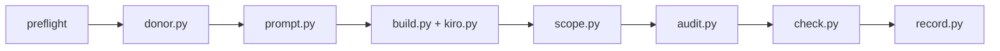

# Design Document: Reanimate

## Overview

`revenant reanimate <slug>` checks inputs, fetches Donor_Captures via Exhume's ArchiveClient, writes the Reanimate_Prompt,
has kiro-cli headless write `server.py` in a Build_Workspace, copies, audits and Checks it under uvicorn. The Runner ships
no server; the Check and P5–P6 test whatever `server.py` exists. New deps: `fastapi`, `uvicorn`.

## Architecture



Order (Req 1.1): file preflight (1.2, no network) → kiro-cli preflight, headless only (`which`, `whoami`, `--version`;
3.3, 4.5; fails fast before any Archive traffic) → donors → prompt → build → scope diff → copy-back → audit → Check →
Build_Record. `--prompt-only` stops after the prompt; `--built-by kiro-ide-chat` skips kiro-cli entirely (4.1–4.3).

Reused from `revenant.exhume`: `load_tombstone`, `Tombstone`, `CdxRow`, `ArchiveClient`, `ArchiveError`, `RateLimiter`,
`SystemClock`, `make_client`, `user_agent`, `get_listing`, `wayback_url`, `served_timestamp`, `parse_query` (HTML-unescapes
`&amp`, F15), `interval`, `has_auth_param`, `EvidenceStore`, `atomic_write`. From `revenant.autopsy`: `load_contract`,
`contract_path`, `parse_body`, `parse_row_date`.

## Components and Interfaces

New modules live in `revenant/reanimate/` (< ~150 LOC each); `ReanimateError(stage, message, code)` is the one failure type.

**Tombstone change** (`revenant/exhume/models.py`, Req 2.1): `donor_symbols`, `donor_required: list[str] = []`;
a `model_validator(mode="after")` names each required symbol missing from `donor_symbols`; `extra="forbid"` stays.

**donor.py** (Donor_Fetcher):
- `candidates(rows: Sequence[CdxRow], symbol: str, mimetypes: list[str]) -> list[CdxRow]` (pure, Req 2.2):
  status 2xx, listed mimetype, timestamp `< "20170501"`, no `has_auth_param`, first `s` of
  `parse_query(original)` equals `symbol`, query `s_only` or Daily_Range (`interval == "d"`, `c` ASCII digits
  ≤ 1999, `f` absent, empty or digits ≥ the timestamp year; Exhume's `full_range` needs `f`, so it is not
  reused). Sort by (timestamp desc, original asc); keep the first row per digest.
- `accept(body: bytes, served: str | None) -> str | None` (pure, Req 2.3): `None` if accepted, else the
  reason. Needs `served < "20170501"`, bytes before the first `\n` exactly the Header_Line, ≥ 1 Data_Row
  (`parse_body`), newest Row_Date `n` with `served_date - 7 days <= n <= served_date`.
- `donor_file_name(symbol: str) -> str` (pure, Req 2.4): keep `A-Z 0-9 . - _`, write every other UTF-8 byte
  (lower-case letters included) as `%XX`, add `.csv`. `^GSPC` → `%5EGSPC.csv`; distinct on Windows too.
- `fetch_donors(tombstone, archive, store, slug_dir) -> DonorReport(stored, missing, required_missing)`:
  reuse a hash-valid entry with zero requests (Req 2.5); else pool `get_listing(..., "data", refresh=False)`
  over all hosts, fetch at most 5 candidates via `archive.get(wayback_url(...))` (an `ArchiveError` counts as
  a tried non-qualifier), `atomic_write` the first accepted body, rewrite `donor/index.json` (Req 2.4, 2.6).

**prompt.py**: `render_prompt(slug, donors) -> str`, `write_prompt` (3.1): relative file names only; no shell or command
tool exists, so Kiro must not run, test or install anything and writes only `server.py`; the Server rules with Gen citations.

**kiro.py**: `KiroCli(command=["kiro-cli"])` with `available()` (`shutil.which`), `whoami() -> int` (stdout discarded,
Req 7.2), `version() -> str` (30 s timeout, Req 4.6), `chat(cwd, log, redactor) -> ChatResult(exit_code: int | None,
timed_out: bool, model: str | None)`. `chat` runs `command + ["chat", "--v3", "--no-interactive", "--trust-workspace",
"--trust-tools=fs_read,fs_write", "--output-format", "stream-json", "Read reanimate-prompt.md in this directory and follow
it exactly."]` in the Build_Workspace; reader threads label lines `stdout: `/`stderr: `, redact and append them to the
Build_Log as they arrive, and keep the first model id an event reports. `chat` and `version` decode with `encoding="utf-8",
errors="replace"` (Windows defaults to cp1252). At 900 s `chat` calls `terminate()`, then `kill()` (Req 3.2, 3.4, 3.5).
Tests pass `command=[sys.executable, "tests/reanimate/fake_kiro.py"]`, a stub for `whoami`, `--version` and `chat`
that copies a canned `server.py` into its cwd or misbehaves per env `FAKE_KIRO_MODE`.

- **build.py**: `make_workspace` (`tempfile.mkdtemp(prefix="revenant-build-")`, copies only the glossary files),
  `copy_back`, `display(path)` (Home_Path → `~`); deletes the workspace on success, keeps it on failure (3.5, 3.6).
- **scope.py**: `snapshot(root, exclude) -> dict[str, str]` (POSIX path → SHA-256) skips the Build_Log, root `.git/`, `.venv/`,
  `.hypothesis/`, `.pytest_cache/`, `.ruff_cache/`, any `__pycache__/`; `diff(before, after)`; any other change fails (7.1).
- **.gitattributes**: `crypt/*/donor/** -text`, `crypt/*/error-404.html -text`; clones keep the bytes, so 2.5 never refetches (7.5).
- **audit.py**: `audit(server) -> list[str]` via `ast`: imports must be `fastapi`, `uvicorn` or in
  `sys.stdlib_module_names`; relative imports and strings containing `evidence/` or `evidence\` fail (7.3, 7.4).
- **redact.py**: `Redactor(api_key, home)(text)`: key, then Email_Like_Strings → `[REDACTED]`, then Home_Path
  spellings, longest first → `~`; applied to prompt, Build_Log, Build_Record and console (7.2).
- **check.py**: `free_port()` (bind `127.0.0.1:0`); `serve` runs `sys.executable -m uvicorn server:app --app-dir
  <slug_dir> --host 127.0.0.1 --port <p>` with cwd = repo root, so a cwd-dependent server fails; `wait_ready`
  (30 s); pure `eval_demo`, `eval_unknown`, `eval_weekly -> CheckResult` (6.2–6.4); `stop` waits 10 s, kills (6.5).
- **record.py**: the models below; `dump_model` follows Exhume's `dump_index` recipe.
- **runner.py**: `reanimate(slug, prompt_only, built_by, deps: Deps) -> Summary`; `Deps` holds `KiroCli`, the
  httpx transport, clock and repo root. The Typer command `reanimate(slug, prompt_only=False,
  built_by="kiro-cli-headless")` sits beside `autopsy` in `revenant/cli.py`.

### Server rules (stated in the Reanimate_Prompt; Req 5, 7.3)

1. Route `GET /table.csv` for any Host (Gen 1.1–1.3); ignore `ignore`, `j`, `q`, `x`, `y`, `z` (Gen 2.8–2.14).
   Load `donor/index.json`, donor files and `error-404.html` relative to `Path(__file__).parent`. Import only
   `fastapi`, `uvicorn` and stdlib. No network, nothing under `evidence/`.
2. A non-empty `g` other than `d` → 404 Error_Page with `X-Revenant-Note: interval <g> is not reanimated yet`,
   checked first (Gen 2.7, deferred). Then `s` absent, empty or without a donor → 404 (Gen 2.11, 7.1). Query
   values arrive percent-decoded, so `^GSPC` and `%5EGSPC` hit the same donor.
3. Start from `a,b,c`, end from `d,e,f` (Gen 2.1–2.6, 3.1, 3.2, 5.1, 5.2). If any of the three is absent, empty or
   not `int()`-able, the whole date is missing → earliest (start) or latest (end) donor Row_Date. Else
   `year = c + a // 12`, `month = a % 12 + 1` (12 → January next year; other out-of-range values roll the same way,
   inferred), day clamped to `1..days_in_month` (inferred); a year outside 1..9999 counts as missing (inferred). Never raise.
4. Split the donor body on `b"\n"`; keep Data_Rows with Row_Date in `[start, end]`, bytes unchanged, donor
   order (newest first). Body = Header_Line + `\n` + each row + `\n`, `text/csv`, 200 (Gen 4.1, 4.2, 4.4,
   4.7). No row in range (start > end included) → 404, `text/html`, Error_Page body (Gen 7.1).
5. Exactly one `X-Revenant-Donor` per response: `wayback:<host>/<served_timestamp>` from `s`'s donor entry, else `none` (Gen 6.1).

## Data Models

```python
# record.py: Pydantic v2, every model ConfigDict(extra="forbid", frozen=True)
class DonorEntry:  symbol: str; file: str; source_url: str; host: str   # host = urlsplit(original).hostname
                   served_timestamp: str; sha256: str; rows: int; first_date: str; last_date: str
class DonorIndex:  slug: str; entries: dict[str, DonorEntry]            # keyed by symbol
class ScopeChange: path: str; change: Literal["created", "changed", "deleted"]
class CheckResult: name: Literal["demo", "unknown_symbol", "weekly"]
                   result: Literal["pass", "fail", "not_run"]; expected: str | None; observed: str | None
class BuildRecord: build_path: Literal["kiro-cli-headless", "kiro-ide-chat"]; prompt_sha256: str
                   kiro_version: str | None; kiro_exit_code: int | None; timed_out: bool; note: str | None
                   model: str | None    # id reported by a stream-json event, else null; never guessed (Req 4.4)
                   started_at: str; ended_at: str                       # ISO 8601 UTC with "Z"
                   scope_changes: list[ScopeChange]                     # [path]; empty = clean (Req 7.1)
                   import_violations: list[str]                         # Req 7.4
                   checks: dict[str, CheckResult | None]                # null = did not run (Req 4.4)
```

## Correctness Properties

*A property is a characteristic or behavior that should hold true across all valid executions of a system-essentially, a formal statement about what the system should do. Properties serve as the bridge between human-readable specifications and machine-verifiable correctness guarantees.*

### Property 1: Donor candidate filter and order

For any list of CDX rows (raw and `%5E` symbols, `&amp` artifacts, any status, mimetype, timestamp, auth-like names,
repeated digests) and any symbol, every returned row meets each Req 2.2 condition, digests are unique, order is
(timestamp desc, original asc), no qualifying digest is lost, and input order does not matter.

**Validates: Requirements 2.2**

### Property 2: Donor acceptance and the 5-try cap

For any body, served timestamp and newest-Row_Date offset of -3 to 12 days, `accept` returns `None` exactly when Req 2.3
holds; and for any sequence of candidate outcomes (qualifies, fails, `ArchiveError`), the fetcher makes `min(5, i + 1)`
fetches for a first qualifier at index `i` (else `min(5, n)`) and stores its bytes unchanged as `donor_file_name(symbol)`,
which uses only `A-Za-z0-9.-_%` and differs after case folding for distinct symbols.

**Validates: Requirements 2.3, 2.4, 2.6**

### Property 3: Redaction removes every secret

For any text embedding a key (16+ characters, not a substring of `[REDACTED]` or `~`), Email_Like_Strings and
Home_Path in all three spellings, the output contains none of them, and redacting twice equals redacting once.

**Validates: Requirements 7.2**

### Property 4: Scope diff is exact

For any snapshot and any set of creations, changes and deletions applied to it, `diff` returns exactly those
paths with their change types in path order, and an empty list when nothing changed.

**Validates: Requirements 7.1**

### Property 5: Served rows equal donor lines in range

For any fixture donor (random newest-first trading days, Yahoo_Number values, `000` volumes) and any Daily_Request whose
`a`–`f` mix in-range ints, 12, out-of-range ints, day 31, empty, absent and junk such as `{{(-1 month).year}}`, with raw or
percent-encoded `s`, the built `server.py` answers as a reference selector predicts: 200 with the Header_Line and exactly
the in-range donor lines, byte-equal, newest first; else 404 + Error_Page.

**Validates: Requirements 5.1, 5.2, 5.3, 5.4**

### Property 6: Donor header and interval gate

For any request, the response has exactly one `X-Revenant-Donor`, equal to `wayback:<host>/<served_timestamp>`
when `s` has a donor and `none` otherwise; and for any non-empty `g` other than `d`, whatever `s` is, the
status is 404 with a non-empty `X-Revenant-Note`.

**Validates: Requirements 5.5, 5.6**

## Error Handling

| Condition | Requirement | Exit |
|---|---|---|
| Tombstone, Contract, Generated_Spec or archived 404 missing/invalid; IDE run without `server.py`/prompt | 1.2, 4.3 | 2 |
| `kiro-cli` not on PATH or `whoami` non-zero; `--version` non-zero, empty or > 30 s | 3.3, 4.6 | 2 |
| Required_Donor_Symbol missing | 2.6 | 1 |
| kiro-cli non-zero, 15-minute timeout, or no `server.py` (workspace kept) | 3.5 | 1 |
| A repository file changed during kiro-cli; disallowed import or `evidence/` path in `server.py` | 7.1, 7.4 | 1 |
| Server silent for 30 s, exits early, or any Check fails | 6.6 | 1 |
| Success, or `--prompt-only` | 1.4, 4.1 | 0 |

Failures print `error: <stage>: <message>` (redacted) to stderr; every finished build writes a Build_Record (4.4).

## Testing Strategy

pytest + Hypothesis, `@settings(max_examples=100)`, one test per property, tagged `# Feature: reanimate, Property <n>:
<title>`. Unit tests are offline: `httpx.MockTransport` serves CDX listings and capture bodies from `evidence/` fixtures,
`tests/reanimate/fake_kiro.py` replaces kiro-cli, and `KIRO_API_KEY` is removed with `monkeypatch`. Property files in
`tests/reanimate/`: `test_donor.py` (P1, P2), `test_redact.py` (P3), `test_scope.py` (P4), `test_server.py` (P5, P6).

P5 and P6 copy the built `server.py` into `tmp_path` beside a fixture `donor/` and `error-404.html`, load it with
`importlib`, drive it with `fastapi.testclient.TestClient`, and skip when no `server.py` exists. The stub kiro-cli copies
a hand-written `tests/reanimate/fixtures/server.py`, so Runner tests never depend on Kiro.

Example tests: `test_tombstone.py` (2.1); `test_kiro.py` (argv, labelled log, timeout, partial log, non-cp1252 bytes,
model id or null); `test_runner.py` (each exit-code row, stage order, zero-request reuse, Error_Page copy, Write_Scope, a
stub printing a fake key, email and home path); `test_audit.py`; `test_check.py`; `git check-ignore`/`check-attr` (7.5).

Live tests (`@pytest.mark.live`): AAPL donor fetch, a real kiro-cli headless build, the demo Check on it. The first 4
tasks deliver this slice (Tombstone + donors; prompt + kiro/build; check; runner + CLI); hardening follows.

## Open Items

1. `kiro-cli whoami` exiting non-zero without a login is unverified (help covers only `chat`, `--version`); confirm for Req 3.3.
